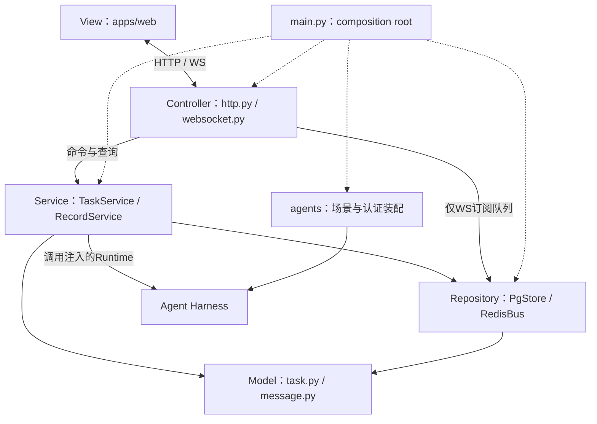
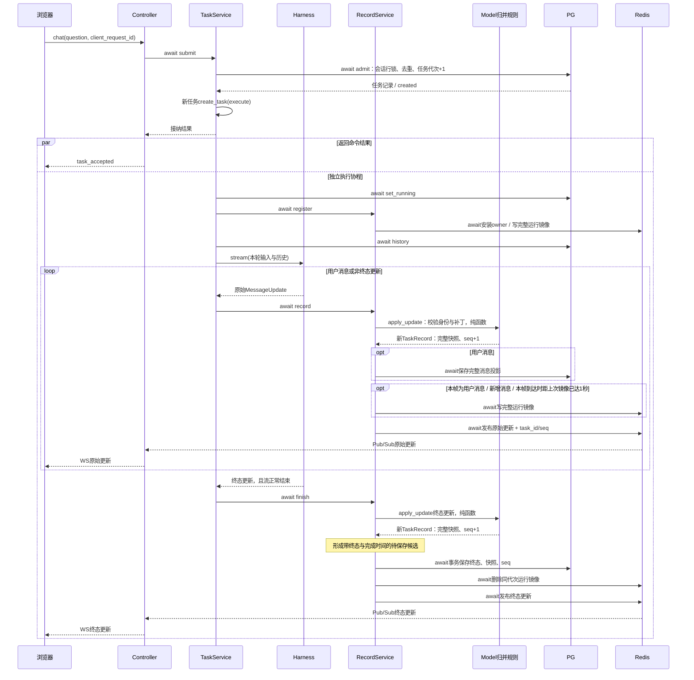

# Mossail 本机首版：运行、链路与验收

更新：2026-11-05。当前实现为一个薄Agent Server、PG、Redis和同仓前端；本文描述本机运行范围。生产部署、容量与故障切换不在本轮验证结论中。

当前目录按MVC＋Service/Repository整理，旧平铺入口已移除。`server_epoch`与明确中断后的检查点回退已纳入工程检查和真实异常退出验收。本文分别说明技术机制、固定场景验证与尚未覆盖的能力。

## 运行

Python依赖要求3.12及以上，由uv锁定。先准备模型认证、检索和中间件配置，参考根目录[.env.example](../../.env.example)；已有`.env.local`继续使用。PG账号需要在目标库创建schema/table的权限，应用使用非superuser账号。

| 配置 | 用途 |
| --- | --- |
| `AGENT_AUTH_MODE`、`AGENT_MODEL`及对应认证配置 | 复用现有模型通道；`api_key`或`chatgpt` |
| `SERPER_API_KEY`及Serper端点 | DeepSearch检索与正文读取；未配置时不注册该场景 |
| `MOSSAIL_DATABASE_URL`、`MOSSAIL_DATABASE_SCHEMA` | PG连接与应用schema，schema默认`mossail` |
| `MOSSAIL_REDIS_URL`、`MOSSAIL_REDIS_NAMESPACE` | Redis连接及key/频道命名空间，默认`mossail:dev` |
| `MOSSAIL_PORT` | 前端、HTTP、WebSocket共用端口，默认8010，`--port`优先 |
| `MOSSAIL_TASK_TIMEOUT` | 一轮Harness执行超时，默认300秒 |

`scripts/dev.py`先读取当前进程环境，再加载`.env.local`；若本轮私人中间件文件`.data/agent-workspace/environment/.env.private`存在，仅额外合并其中的`MOSSAIL_*`。该合并不覆盖模型认证和模型路由配置。

本机验证使用PG `127.0.0.1:15432`和Redis `127.0.0.1:16379`，PG数据库为`mossail_dev`，应用角色`mossail`。两个验证实例只绑定本机地址，数据使用各自Docker命名卷。这份私人环境目录、实例和凭证不随公开源码交付；新的源码副本需自行准备PG/Redis并填入配置。中间件启停由对应实例的管理方式负责，先启动中间件，再启动Server；关闭时先停Server，再停中间件。

本地旧工作区的根`compose.yaml`仍为历史双服务应用配置，未适配此版，也不属于本次发布或已验收的启动路径。

```bash
uv sync --project apps/agent --frozen
python3 scripts/dev.py --skip-sync --port 8010 --background
python3 scripts/dev.py --status
```

打开[http://127.0.0.1:8010](http://127.0.0.1:8010)。后台日志在`.data/runtime/mossail-agent.log`；状态文件记录本脚本创建的PID、启动时间与命令，停止前会重新核对。重复启动复用已记录进程，端口冲突会报错，脚本不会按端口停止其他项目。

```bash
curl -fsS http://127.0.0.1:8010/health
python3 scripts/dev.py --stop
```

健康检查应包含`service=mossail`、`ready=true`、`storage.postgres=true`和`storage.redis=true`；`agent.agents`列出可用场景，`server_epoch`标识当前服务实例。`ready`只代表当前连接、模型装配及待保存状态满足启动条件，不能替代真实生成或页面验收。去掉`--background`可前台运行，Ctrl+C停止。

## 技术链路

这里的MVC表示交互职责：`apps/web`是View，HTTP/WS入口是Controller，任务数据对象是Model。Service承担业务时序，Repository承担中间件访问，`agents/`承担场景与模型认证装配，`main.py`是composition root。MVC并不要求代码只能分成三个目录；MVC的Model也不等同于LLM模型客户端。

按以下顺序阅读代码，每步围绕一次提问展开。

| 模块 | 输入、处理与输出 |
| --- | --- |
| [main.py](../../apps/agent/src/agent_service/main.py) | 组合Agent工厂、Repository、Service、Controller和View；获取PG单Server所有权，收尾旧任务；退出时先关闭任务，再关闭中间件和模型资源 |
| [controllers/http.py](../../apps/agent/src/agent_service/controllers/http.py)、[controllers/websocket.py](../../apps/agent/src/agent_service/controllers/websocket.py) | HTTP/WS解析命令、调用Service、返回接纳结果；WS管理订阅、完整同步与socket，HTTP与WS共用TaskService |
| [models/task.py](../../apps/agent/src/agent_service/models/task.py)、[models/message.py](../../apps/agent/src/agent_service/models/message.py) | TaskRecord、TaskAdmission等dataclass与纯消息归并规则，描述任务身份、状态、代次、seq与完整消息快照；不持有数据库/socket/协程 |
| [services/tasks.py](../../apps/agent/src/agent_service/services/tasks.py) | 校验场景/模型，接纳后创建独立`asyncio.Task`；读取历史，调用本地Harness，控制超时、取消和终态保存 |
| [services/records.py](../../apps/agent/src/agent_service/services/records.py) | 将原始更新应用到服务端消息快照，递增任务seq；按分支调用Repository写PG/Redis并发布；生成完整sync，处理待保存终态 |
| [repositories/postgres.py](../../apps/agent/src/agent_service/repositories/postgres.py) | 保存会话、任务命令、代次、完整消息投影和终态；事务内锁会话完成接纳/去重，保存时锁任务，拒绝旧seq与终态改写 |
| [repositories/redis.py](../../apps/agent/src/agent_service/repositories/redis.py) | 保存带TTL的完整运行镜像，Lua检查任务代次和seq；Pub/Sub传输原始更新，订阅ACK后才开始接收；慢订阅者断线后重新同步 |
| [agents/registry.py](../../apps/agent/src/agent_service/agents/registry.py)、[model_access.py](../../apps/agent/src/agent_service/agents/model_access.py)、[chatgpt_auth.py](../../apps/agent/src/agent_service/agents/chatgpt_auth.py) | 返回AgentRegistry数据对象，包含场景工厂、模型身份与执行元数据；不访问FastAPI app.state，由main装配并注入，TaskService调用工厂创建的Runtime |
| [errors.py](../../apps/agent/src/agent_service/errors.py) | 跨层异常类型，供Controller转换响应、Service处理记录失败、Repository屏蔽底层凭证细节 |
| [stream-state.js](../../apps/web/stream-state.js)、[components.js](../../apps/web/components.js)与[页面](../../apps/web/index.html) | 浏览器维护独立消息副本，检查水位并应用增量；完整sync替换当前会话副本；按type选择组件、按meta_data渲染 |

主业务调用为`Controller → Service → Repository`，Service与Repository使用Model；Model没有指向Controller或中间件的反向依赖。HTTP健康检查通过`TaskService.health()`调用探针；WS Controller通过注入的RedisBus管理订阅队列，不读写持久化或运行镜像，也不接管任务执行。实线表示对象调用/数据依赖，虚线表示组合入口注入；这张职责图不表示消息的时间先后，也不表示Service导入了具体Repository类。

静态代码依赖另有边界：`services/`通过注入的store、bus和Runtime工厂调用，未导入具体仓储；`repositories/`依赖Model、协议、异常与驱动，不反向依赖Service或Controller。`models/`只包含数据和纯归并，`errors.py`不反向依赖其他层。

[test_architecture.py](../../tests/mossail/test_architecture.py)检查主要反向导入；它约束源码依赖，不证明运行与恢复行为已经通过。



一次已接纳任务的记录与发送顺序如下。图中的`await`先后来自当前源码，PG事务不包含Redis或WebSocket发送。



WS连接先等待Redis订阅ACK，再在会话记录锁下取得完整sync；先发送sync，然后发送订阅期间排队的增量。sync包含`server_epoch`、`heads`、任务状态、`save_pending`保存标记及完整`MessageItem`；普通帧携带原始`add/replace/patch`和`stream={task_id,seq}`，不会把服务端完整快照替换成每个文本增量。

`server_epoch`在服务实例创建RecordService时生成，同一进程的sync、heads和health使用同一标识。它与任务`generation`不同：generation区分同会话的任务代次并约束Redis写入；epoch用于识别服务实例切换和恢复检查点。

例如同一条`task=t1/msg=answer`收到`patch /meta_data/content="126"`：服务端内存先从空正文得到正文126的完整消息，任务seq递增；Redis按条件保存这份完整任务镜像；Pub/Sub和WS发送原始patch及seq。浏览器在自己的旧消息副本应用patch后才显示126。此时该增量不一定已进入PG；完整终态提交后才构成已保存的完成结果。示例ID和字段变化用于说明机制，不是额外验收数据。

浏览器按`task_id+msg_id`区分消息，重复/旧seq忽略；发现序号缺口或patch缺少基线时请求`sync_request`。服务端每10秒无更新时发送一次带epoch的`heads`检查，使最后一帧丢失也能触发完整同步。完整sync通过校验后才整体替换浏览器副本，旧socket和旧会话帧不再应用。同epoch的旧同步水位继续被拒绝；跨epoch检查点恢复规则见下节。

## 失败与恢复边界

- **接纳与重复提交**：同一会话的相同`client_request_id`返回同一个任务，不重新创建执行；不同请求在该会话已有`submitted/running`时被拒绝。没有提供请求ID的外部调用不具备这层重复提交去重。
- **记录失败**：用户消息写PG失败会中止当前执行并进入失败收尾。终态PG提交失败会重试，仍失败则保留进程内pending并发送`recording_error`，不发布成功终态；新提交被拒绝。即使页面错过错误帧，重连sync的`save_pending`也能恢复“重试保存”状态；按钮只重试保存该候选，不重新调用模型。
- **Redis失败**：运行镜像写/删或发布失败会记录计数，PG已提交状态保留。Pub/Sub不保存可重放日志，浏览器依靠完整sync修复丢失更新。PG与Redis之间没有跨介质原子提交，也没有“发布成功即页面已应用”的确认。
- **关闭页面或断网**：清理的是订阅连接，执行任务由TaskService持有并继续。刷新/重连恢复的是消息与任务状态副本。
- **停止与超时**：停止请求取消执行，并等待SDK事件流收尾、关闭及后台run loop结束；正常取消收尾为`abandon`。若取消清理等待超时，则保存`failed`和“未确认上游停止”，不能把本地取消请求当作上游已停止的证明。任务超时或缺少终态的EOF也收尾为`failed`。正在保存终态时不重复取消或重新执行。
- **引用校验**：DeepSearch只接受已登记且正文已读取的来源ID；`〔cit-1〕`、`【cit-1】`会先规范化成`[cit-1]`，再做来源校验。模型直接生成的HTTP/HTTPS URL、未登记或未读取的引用会被拒绝，任务返回`failed`；可点击链接由程序依据登记来源生成。
- **Server异常退出**：下次启动读取PG未完成任务，若存在同task/generation且seq更新的Redis镜像，采用该镜像后提交`failed`及`INTERRUPTED`说明。它不重建旧模型调用、工具现场或Agent循环；用户需要重新提交。Redis镜像不在时，只能保留此前PG已提交的消息。

### 明确中断后的检查点回退

UI已收到的增量可能领先于Redis检查点。以下使用教学ID与序号说明恢复规则，真实验收结果另列在后文：

| 对象 | 异常退出前 | 新服务完成恢复后 |
| --- | --- | --- |
| 服务实例 | epoch A | epoch B |
| Redis完整运行镜像 | task t1保存到seq5 | 读取seq5后，终态PG提交成功再删除镜像 |
| PG任务 | t1为未完成状态 | 在seq5检查点增加中断结果，保存`failed/INTERRUPTED`、seq6 |
| 已打开页面 | t1已显示到seq10 | 新socket首个有效sync确认epoch B，将该中断任务整体替换为seq6检查点 |

页面只有在新连接的首个有效sync确认epoch改变，且回退任务明确为`failed`、错误包含`INTERRUPTED`时，才允许采用较早检查点。已确认终态不能被改写成另一终态；同epoch继续拒绝水位回退；旧socket的任何帧仍被隔离。`heads`仅用于对照和触发同步，不能直接切换epoch或提升本地水位。界面会提示已经恢复保存检查点，并要求重新提交任务。

Redis普通文本镜像的1秒是**新帧到达时检查的节流门槛**。它没有独立定时flush：若最后一条帧尚未达到写镜像条件，此后没有新帧，就不会因时间流逝自动保存。异常退出可能丢失页面已经显示、但尚未进入PG或Redis检查点的文本/工具更新；不承诺保留最后每个字符，也不能把1秒解释为最大数据损失窗口。

首版固定一个Server进程、一个uvicorn Worker，PG会话锁防止同一schema同时运行第二个Server。不同会话可在一个事件循环内执行，但没有容量基准或多进程执行分派保证。`pending`终态候选属于进程内状态，不能当作崩溃后可重试的持久任务队列。

## 本机验收记录

本轮运行服务的`health.agent.execution.source_sha256`为`92b5bb13fa2dd7e090bbde31e43902f213727f1b10a58a3a1607eb4812c361a9`。工程用例与真实运行分别验证以下范围；前端显示还通过对应浏览器检查核对。

| 验证层次 | 结果与范围 |
| --- | --- |
| Python工程回归 | 87项通过：59项Agent、28项Mossail。包含SDK与记录替身测试、真实PG/Redis随机schema/namespace联调、MVC依赖边界；覆盖接纳、终态、代次、seq、Pub/Sub、取消、超时、EOF、重启收尾和安全引用格式；隔离生命周期Runtime替身不调用模型 |
| 前端状态、页面逻辑与组件 | 28项通过，覆盖重复/缺口、同步替换、断线提交、会话切换、记录失败、新连接切换epoch及仅明确中断任务的检查点回退；同epoch回退拒绝与旧socket隔离保留 |
| 单Server装配 | 启动、正常停止、重启、重复启动复用进程；首页/静态资源、REST线程、WS sync/ping及空线程重启后可读通过 |
| 真实HTTP/WS模型链路 | 两轮计算均complete，答案/工具结果为126/126.0、130/130.0；第二轮使用同会话上下文；重复请求返回同一task；运行中断WS后独立执行继续并能sync；历史读取通过 |
| DeepSearch完成与刷新 | 最终版PEP 654任务complete、seq9；实际检索与正文读取2次工具调用成功、1条引用；完成后刷新消息区逐字一致，运行中刷新亦通过 |
| DeepSearch停止 | 模型等待阶段且尚无工具调用时取消；abandon、seq3；PG与GET任务状态一致、Redis镜像删除，刷新仍显示已停止 |
| 真实Server异常退出 | SIGKILL后从Redis检查点seq3恢复PG `failed/INTERRUPTED` seq4，重启epoch切换；浏览器显示中断结果，Agent没有自动重跑 |

工程检查命令：

```bash
apps/agent/.venv/bin/python -m pytest tests/agent tests/mossail -q
node --test tests/web/*.test.mjs
```

前端工程检查在Node 22环境验证。真实PG/Redis检查需要已配置中间件；缺少连接配置时可能跳过，不能将“全部跳过”记成联调通过。原始请求、帧、运行指纹与内部验收清单保存在本机运行工作区，不作为公开源码或正式汇报正文的一部分。

检索与正文读取依赖外部网络，验收期间的网络故障已恢复。健康检查、固定计算与检索场景通过，不代表开放域回答质量、容量、长期稳定性或生产部署均已验证。

## DeepSearch完成与停止的范围

| 项目 | 本文记录状态 |
| --- | --- |
| DeepSearch完整回答 | 最终版PEP 654任务complete、seq9，2次工具调用成功、1条引用；完成后刷新消息区逐字一致，运行中刷新亦通过 |
| DeepSearch停止 | 模型等待、0工具调用时取消；abandon、seq3，PG与GET一致、运行镜像删除，刷新仍显示已停止 |

停止验证覆盖的是模型等待且尚未调用工具的阶段。其他工具的取消能力、已经发生的远程写入或外部副作用能否撤销，需要按工具另行定义和验收，不能从此用例推断。

本地旧工作区的Backend、SQLite历史数据和根应用compose继续保留原型用途，不属于本次发布。本轮没有验收应用容器、多Worker或跨实例续跑；DAG、第二SDK、复杂HITL与RSI环境适配留待后续独立实施和验收。
